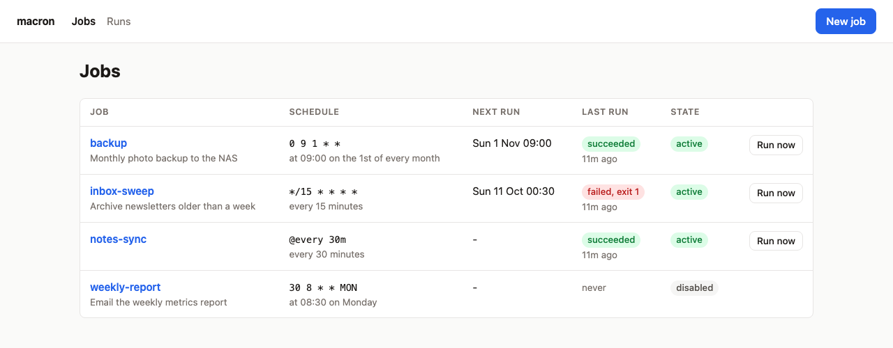
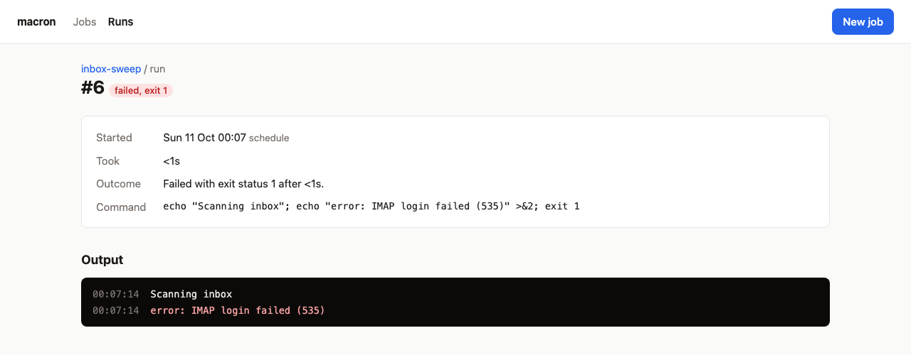

# macron

Schedule, run and watch local jobs on macOS.

macron is cron for a Mac that sleeps. You describe your jobs once; macron installs them into
launchd, which runs them on schedule, including runs missed while the Mac was asleep. Every run is
recorded with its output, so you can see what happened. Manage it all from the command line, or type
`macron up` and use the browser. Every command speaks JSON, so scripts and agents can drive it as
easily as you can.



> **Status: early.** Everything below works and is tested. Until 1.0, a release can change the
> command line or the JSON output; [the changelog](CHANGELOG.md) says when one does.

## Why not cron?

cron skips any job whose time comes while your Mac is asleep, and tells you nothing when a job
fails. launchd, which macOS ships, runs a missed job when the Mac wakes, but it is configured with
XML files and `launchctl`, and keeps no history. macron gives you cron's schedules on top of
launchd, a record of every run, and a notification when one fails.

## Install

With the installer from the [latest release](https://github.com/realzai/macron/releases/latest),
which puts `macron` in `~/.cargo/bin`:

```sh
curl --proto '=https' --tlsv1.2 -LsSf https://github.com/realzai/macron/releases/latest/download/macron-cli-installer.sh | sh
```

Or from source, with [Rust](https://rustup.rs) 1.89 or newer:

```sh
cargo install macron-cli
```

## Use

### In the browser

```sh
macron up
```

This opens macron in your browser, signed in. Add and edit jobs (the schedule is described as you
type it), run one now and watch its output arrive, and look back through every run. Press Ctrl-C to
stop it. The page is served on `127.0.0.1` only, and only to the browser `macron up` signed in, so
other websites cannot reach it.



### On the command line

```sh
# Add a job: a name, a schedule, and the command after --.
macron add backup --schedule '0 9 1 * *' -- ~/bin/backup.sh
macron add sweep -s '@every 15m' --timeout 5m -- 'cd ~/inbox && ./sweep --all'

macron ls                  # every job, its next run and its state
macron show backup         # one job in full
macron edit backup -s '0 10 1 * *'
macron disable sweep       # uninstall, but keep it in jobs.toml
macron enable sweep
macron rm backup
```

```
NAME    SCHEDULE    NEXT RUN         LAST RUN               STATE
backup  0 9 1 * *   Sun 1 Nov 09:00  succeeded 9d ago       active
sweep   @every 15m  -                failed, exit 1 2m ago  active
```

### Runs and logs

```sh
macron run backup            # run it now, through launchd, as its schedule would
macron run backup --wait     # ...and watch its output, exiting as it did
macron runs                  # recent runs of every job
macron runs --status failed
macron logs sweep            # the latest run's output, stderr in red
macron logs sweep --follow   # keep printing until the run ends
macron logs sweep --run 41 --raw | grep error
```

Each run's output is kept, up to 10 MiB, along with when it ran, how long it took and how it ended.
The newest 100 runs of each job are kept; set `keep_runs` to change that. By default macOS posts a
notification when a run fails; set `notify` to `always` or `never` to change that.

### Schedules and `jobs.toml`

Schedules are five-field cron (`minute hour day-of-month month day-of-week`, with names such as
`MON` and `JAN`), a shorthand (`@hourly`, `@daily`, `@weekly`, `@monthly`, `@yearly`), or
`@every <duration>`.

Jobs are kept in `~/.config/macron/jobs.toml`, which you can edit by hand. Run `macron apply`
afterwards to bring launchd in line with it. Changes made from the CLI or the browser keep your
comments and formatting.

```toml
[jobs.backup]
schedule = "0 9 1 * *"
command = "~/bin/backup.sh"
description = "Monthly photo backup"
timeout = "2h"
env = { BACKUP_TARGET = "/Volumes/Backup" }
notify = "always"
```

Each command runs in a login shell (`/bin/zsh -lc` by default), so your `PATH`, Homebrew's
included, is set up as in a terminal. A login shell that is not interactive reads `~/.zprofile`
but not `~/.zshrc`, so set `PATH` in `~/.zprofile`.

### When something goes wrong

```sh
macron doctor
```

`doctor` checks everything that can stop a job running without a sound: `jobs.toml`, launchd, each
job's shell and working directory, the macron binary installed jobs run, the run history, and
recent errors macron could not record. For each problem it says how to fix it.

## For agents and scripts

Every command takes `--json`, prints one JSON document, and reports errors as JSON with a stable
`code`. [`docs/json.md`](docs/json.md) describes all of it, and [`docs/cli.md`](docs/cli.md) every
command and option.

The [macron skill](skills/macron/SKILL.md) teaches an agent to add, change, run and remove jobs,
and to work out why one failed. Install it for Claude Code, Codex, Cursor and other agents with:

```sh
npx skills add realzai/macron
```

## Good to know

- **Sleep and power-off.** launchd runs a job missed while the Mac slept, once, when it wakes. A job
  missed while the Mac was off is not run.
- **Full Disk Access.** A job that reads `~/Documents`, `~/Desktop`, `~/Downloads` or another
  app's data needs Full Disk Access granted to `macron`, in System Settings under Privacy &
  Security. A rebuilt or upgraded `macron` can need it granted again; `macron doctor` says which
  binary to add.
- **Moving or upgrading macron.** Installed jobs run the `macron` that installed them. If it moves,
  `macron doctor` says so and `macron apply` points them at the new one.
- **Daylight saving.** On the nights the clocks change, a job scheduled inside the skipped or
  repeated hour runs when launchd decides, which can differ from the predicted next run.
- **Schedule changes need launchd to hear about them; command changes do not.** `macron add`,
  `edit`, `enable` and `disable` update launchd themselves. After editing `jobs.toml` by hand, run
  `macron apply`. A job's command is read when it runs, so a changed command takes effect on the
  next run either way.

## Contributing

See [`AGENTS.md`](AGENTS.md). It applies to people as much as to agents.

## License

[MIT](LICENSE)
